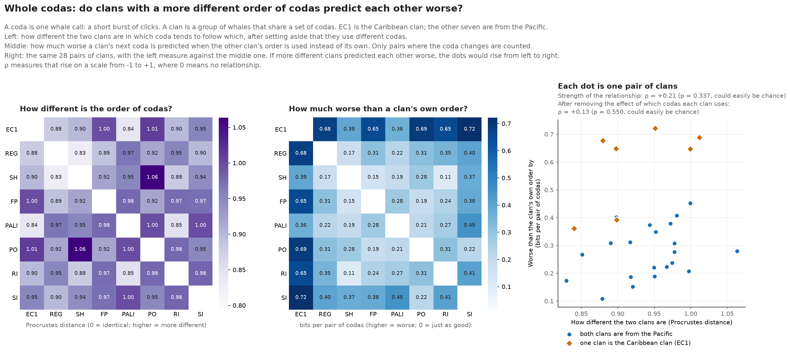

# coda-recovery

**Do sperm whales put their calls in a meaningful order, and is that order the same in every clan?**

Sperm whales call in short bursts of clicks, called codas. This project uses
published recordings of eight clans of sperm whales to ask two questions. Does
knowing the current coda help to predict the next one? And does what is learned from
one clan help to predict another?

It is a Python project. The code prepares the data, builds the predictions, tests
them on recordings that were kept aside, measures how certain the results are, and
draws the figures.

## Results

**In short:**

- In every clan, knowing the current coda helps to predict the next one. Most of
  that help comes from whales repeating the same coda.
- Clans do seem to put their codas in a different order, and the difference is in
  rhythm. How the length of one coda follows the length of the one before is much
  the same in every clan.
- The hope was that one number, a Procrustes distance, could measure how far two
  clans' orders have drifted apart. So far it cannot. That is a null result, and it
  is reported as one.

### Words used here

| Word | Meaning |
|---|---|
| Coda | One whale call: a short burst of clicks. |
| Clan | A group of whales that share a set of codas. This study has eight: one from the Caribbean (EC1) and seven from the Pacific. |
| Rhythm | The pattern of gaps between the clicks of a coda. Each coda is placed in one of 18 rhythm classes. |
| Tempo | How long the whole coda lasts. Each coda is placed in one of five length groups. |
| Coda type | A rhythm and a tempo together. Two codas are the same type only if both match. |
| Inventory | Which coda types a clan uses, and how often it uses each one. |
| Order | Which coda tends to follow which. This is separate from inventory: two clans could use the same codas in a different order, or different codas in the same order. |
| Bits | The unit of the score. A gain of 1 bit means the prediction was twice as good: it gave twice the probability to the coda that really came next. A gain of 0 means no better, and a gain below 0 means worse. |

### How a prediction is scored

Two predictions of the next coda are compared. The first knows only how common each
coda is in that clan. The second also knows the current coda. Both are tested on
recordings that were kept aside and not used to build them. The score is how many
bits better the second prediction is. If the score is above zero, the order of the
codas carries information that their frequency alone does not.

### What the data show

1. **Order helps.** Counting every pair of codas that follow each other, the gain
   for tempo is between +0.15 and +0.86 bits in the eight clans, and is clearly above
   zero in all of them. The gain for rhythm is between +0.07 and +0.78, and is clearly
   above zero in seven of the eight.
2. **Most of that is repetition.** Whales often repeat a coda, and a repeat is easy
   to predict. Counting only the pairs where the coda changes, the gain for tempo
   falls to between +0.03 and +0.64 and is clearly above zero in four clans. The gain
   for rhythm falls to between -0.03 and +0.28 and is clearly above zero in none.
3. **A prediction built from other clans does badly.** A model built from seven clans
   predicts the eighth clan's changes worse than that clan's own coda frequencies do,
   on average: -0.11 bits for tempo and -0.68 for rhythm. But this model brings the
   other clans' inventory with it, and clans use different codas. So this result says
   little about order.
4. **With inventory removed, another clan's order still does badly.** This is the
   main result. It is explained in the next section.

"Clearly above zero" means that the 95% interval does not include zero. For points
1 and 2 the intervals come from 500 resamples of whole recordings.


### Do clans put their codas in a different order?

The idea behind this project is that each clan has its own order, and that these
orders slowly drift apart, as dialects of a language do. If so, a measure of
distance between two clans' orders should tell us how badly one clan predicts the
other. The measure tried here is the Procrustes distance (0 means two patterns are
identical; a larger number means they are more different).

The difficulty is that clans differ first of all in their inventory. That
difference is large, and it hides everything else unless it is removed. It took
three attempts to remove it.

**Attempt 1: whole codas, inventory not removed.** Clans that are further apart by
Procrustes distance do predict each other worse. But both numbers simply follow how
different the two inventories are. When that is taken into account, no link is
left. The distance was measuring which codas a clan uses, not their order.

**Attempt 2: one feature at a time, inventory removed.** Looking at tempo alone and
using only the tempo groups that every clan uses, the order of tempos turned out to
be mostly shared between clans. But a coda is a rhythm and a tempo together, so
this says how one feature of a coda behaves, not how codas are ordered. Clans share
too few whole coda types for this method to work on whole codas.

**Attempt 3: whole codas, inventory removed.** Each clan's order is described by
four small tables: how the next rhythm depends on the current rhythm, how the next
tempo depends on the current tempo, and the two mixed cases (rhythm to next tempo,
tempo to next rhythm). These small tables can be measured well even when a whole
coda type is rare. To predict clan B with clan A's order, A's tables are combined
with B's own inventory, so the only thing taken from A is its order.

The table below shows the result for pairs where the coda changes. "Own order" is a
clan predicted with its own order. "Another clan's order" is a clan predicted with a
different clan's order, averaged over all 56 such combinations. The numbers are
gains in bits, with 95% intervals in brackets.

| Which order is used | Own order | Another clan's order | Better than no order in |
|---|---:|---:|---:|
| Tempo to tempo only | +0.17 (+0.10 to +0.24) | +0.09 (+0.02 to +0.14) | 45 of 56 |
| Rhythm to rhythm only | +0.10 (-0.03 to +0.17) | -0.13 (-0.20 to -0.09) | 8 of 56 |
| Whole coda | +0.21 (+0.04 to +0.32) | -0.15 (-0.24 to -0.07) | 8 of 56 |

What this shows:

- **Clans put whole codas in a different order.** Using another clan's order is
  worse than using no order at all. It gives the wrong idea of what comes next. This
  is also true among the seven Pacific clans alone (better than no order in only 5 of
  42 combinations).
- **The difference is in rhythm, not tempo.** Another clan's tempo order still
  helps. Another clan's rhythm order does harm.
- **Rhythm and tempo seem to be ordered separately.** The two mixed tables add
  nothing to a clan's own score.
- **The method does not create this result by itself.** As a check, all eight clans
  were simulated with one shared order, each with its real inventory and its real
  number of recordings. The same analysis then finds that another clan's order helps
  in 55 or 56 of the 56 combinations.
- **Procrustes distance still does not measure the difference.** Clans whose orders
  are further apart by this distance do not predict each other clearly worse
  (ρ = +0.21, p = 0.34).

In the last point, ρ (rho) is a number from -1 to +1 that says how strongly two
measures rise together; 0 means no link. p is the chance of seeing a link this
strong if there were really none; a p above 0.05 is usually read as "this could
easily be chance".



**Where this leaves the question.** Clans share how the length of a coda follows
the one before, and differ in how its rhythm does. Whether that difference grows in
a way that a distance can measure has not been shown.

Things to keep in mind:

- **The intervals are partial.** They show how much the result changes with the
  choice of recordings kept aside for testing. They do not show how much it would
  change with a different set of recordings to build the models from.
- **Rhythm is the weaker part.** The rhythm classes come from Caribbean codas.
  Pacific codas are placed in the nearest class, which is only approximate. Also, a
  clan's own rhythm order predicts its changes only weakly: its interval reaches zero.
- **Shared tempo order may be simple.** The length groups run from short to long, so
  two codas of similar length fall in the same or a neighbouring group in any clan.
  Some of the shared tempo order may be this, and not a rule about order.
- **One result was not planned and is not claimed.** When repeated codas are counted
  too, most order is shared, because every clan repeats codas, and Procrustes
  distance does follow how much worse clans predict each other (ρ = +0.49, p = 0.04).
  The planned test counted changes only, and this link becomes weaker once inventory
  is taken into account (ρ = +0.35, p = 0.14).
- **A similar claim was made before and withdrawn.** An earlier version of this
  project said that tempo order is shared and rhythm order is not, and took the claim
  back because its comparison was unfair (see
  [History and corrections](#history-and-corrections)). The result here looks similar
  but comes from a different method, and should be judged on that method.

[Methods and results](SUMMARY.md) gives the exact definitions, the checks and the
full tables for all three attempts.

## What this does *not* show

- **Nothing about meaning or syntax.** This measures prediction of recorded token
  sequences. It does not identify meaning, syntax, or individual whales' choices.
- **Not one whale's choices.** Speakers are pooled in the main analysis.
- **Not a like-for-like comparison of oceans.** The Caribbean and Pacific data were
  collected differently, and shared processing does not remove those differences.

See [limitations](limits.md) for the full list.

## Reproduce

The committed CSVs and figures can be inspected without downloading data.
The September 2026 rerun used Python 3.14.5; direct dependency versions are pinned.

```bash
python -m venv .venv
# Linux/macOS:
source .venv/bin/activate
# PowerShell alternative: .venv\Scripts\Activate.ps1
python -m pip install -r requirements-dev.txt

python data/fetch.py all
python data/fetch.py all --verify
```

The fetcher checks input SHA-256 digests against [the source manifest](data/sources.json).
Raw data are fetched separately; source details are in [provenance](data/raw/PROVENANCE.md).
The source includes Python pickles, read during EC1 preprocessing and rhythm-template
loading. Only use the recorded inputs.

Set the source path once:

```bash
export PYTHONPATH=src
# PowerShell alternative: $env:PYTHONPATH = "src"
```

Then run:

```bash
python -m coda_recovery.predictive_info_sweep
python -m coda_recovery.universal_structure
python -m coda_recovery.clan_similarity
python -m coda_recovery.drift
python -m coda_recovery.ordering_drift
python -m coda_recovery.coda_ordering
python -m coda_recovery.ec1_pacified
python -m coda_recovery.plain_figures
python -m pytest
```

These commands replace the corresponding files in `results/` and `figures/plain/`.
Tests cover independent and deterministic sequences, the changes-only baseline,
recording folds, bootstrap refitting, and cross-clan transfer.

## Read the code

| File | Purpose |
|---|---|
| [standardize.py](src/coda_recovery/standardize.py) | Shared tokenization and adjacent recording pairs |
| [predictive_info.py](src/coda_recovery/predictive_info.py) | Model scores, grouped cross-validation, recording bootstrap |
| [universal_structure.py](src/coda_recovery/universal_structure.py) | Leave-one-clan-out comparison |
| [clan_similarity.py](src/coda_recovery/clan_similarity.py) | Pairwise transfer and descriptive embedding distances |
| [drift.py](src/coda_recovery/drift.py) | Mantel tests relating Procrustes distance to lost predictability |
| [ordering_drift.py](src/coda_recovery/ordering_drift.py) | The same question for one feature at a time, with coda frequencies taken out |
| [coda_ordering.py](src/coda_recovery/coda_ordering.py) | Factored model of whole-coda ordering; transfer between clans on each clan's own inventory |

## History and corrections

The name comes from an earlier attempt to recover coda labels by graph matching.
[Development history](PROGRESS.md) records that change of direction.

**Correction, September 2026.** An earlier version of the changes-only comparison
used a baseline that still assigned probability to the excluded current coda.
Independent five-token data could therefore score about +0.32 bits solely because
repeats were removed. The baseline now accounts for the exclusion, and the earlier
claims of a universal tempo rule and above-zero changes-only effects in every clan
have been withdrawn. [Methods and results](SUMMARY.md#correction-to-the-earlier-analysis)
explains the correction.

## License and credits

The code is released under the [MIT License](LICENSE). The data are not mine and are
not redistributed here: the Caribbean recordings are from Sharma et al. (2024) and the
Pacific recordings from Hersh et al. (2022), fetched from their public deposits as
described in [provenance](data/raw/PROVENANCE.md).

Built with AI coding assistance (Claude Code). The questions, the analysis decisions
and the conclusions are mine.
