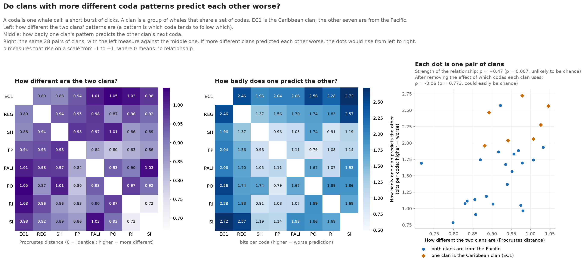
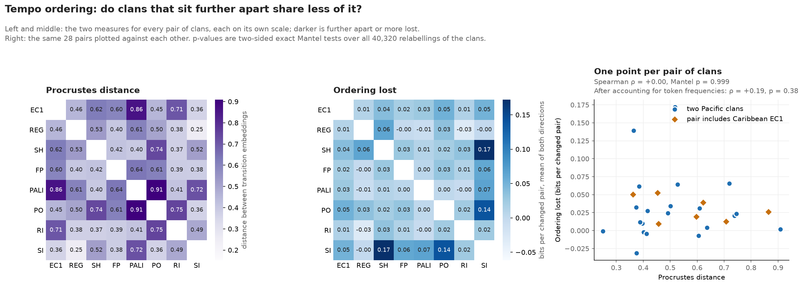

# coda-recovery

**Does the order of sperm-whale codas carry predictive information, and does it carry over from one clan to another?**

Python analysis of adjacent sperm-whale codas across eight vocal clans. The project
compares frequency-based and first-order sequence models on held-out recordings,
then tests whether sequence models transfer between clans.

A coda is a patterned burst of clicks. Here each coda is represented by a rhythm
class and a duration bin. The implementation covers data preparation, recording-level
cross-validation, conditional baselines, uncertainty estimation, and result figures.

## Results

**Knowing the current coda helps predict the next one in every clan. The advantage
shrinks sharply once repeated codas are set aside. Whether clans order their codas
differently is not yet answered: a whole model does not transfer between clans, but
that is mostly because clans use different codas. One feature of a coda, its tempo,
follows a largely shared pattern. The ordering of whole codas has not been tested
with inventory accounted for.**

The score is a gain in bits per coda pair: how much better a model that sees the
current coda predicts the next one than a model that only knows how common each
coda is, on recordings neither model was fitted to. Above zero means order carries
information beyond frequency. Tempo (duration) and rhythm (click pattern) are
scored separately.

- **Order is predictive.** Across all adjacent pairs, tempo gains run from +0.15 to
  +0.86 bits per pair and are clearly above zero in all eight clans. Rhythm gains run
  from +0.07 to +0.78 and are clearly above zero in seven of eight.
- **Most of that is repetition.** Whales often repeat a coda, and a repeat is easy to
  predict. Scoring only the pairs where the coda changes, tempo gains fall to +0.03 to
  +0.64 and stay clearly above zero in four of eight clans. Rhythm gains fall to
  between -0.03 and +0.28 and are clearly above zero in none.
- **A whole model does not transfer between clans.** A model fitted on seven clans
  predicts the eighth clan's changes better than that clan's own coda frequencies for
  tempo in three of eight clans (EC1, REG, SI), and for rhythm in none. On average it
  does worse than frequencies alone: -0.11 bits for tempo and -0.68 for rhythm.
- **One feature, tempo, mostly does.** That model carries the other clans' coda
  frequencies with it. When only the ordering is carried over and the frequencies are
  the target clan's own, another clan's tempo ordering improves prediction in 42 of 56
  clan-to-clan comparisons, and gains +0.07 bits on average against +0.10 for a
  clan's own ordering. This is about how duration changes from one coda to the next.
  A coda is a rhythm and a tempo together, and the ordering of whole codas is not
  tested by it (see below).


"Clearly above zero" means the 95% interval excludes zero. Intervals come from 500
bootstrap resamples of whole recordings, with five-fold cross-validation by
recording. The transfer figures are point estimates without intervals.
[Methods and results](SUMMARY.md) has the definitions, the full tables and the
combined rhythm-and-tempo results.

### Is the ordering clan-specific?

The hypothesis behind this project is that each clan has its own sequence
structure, and that the Procrustes distance between two clans' structures could
serve as a proxy for a kind of "linguistic drift" between them: clans that sit
further apart should preserve less of each other's predictability. So far the
results do not support it. This is a null result, reported as one.

**First test.** Across the 28 pairs of clans, Procrustes distance does track how
much predictability is lost between them (Spearman ρ = +0.47, exact Mantel
p = 0.007). But both measures also track how different the two clans' coda
inventories are, and once inventory is accounted for nothing is left (partial
ρ = -0.06, p = 0.77). As first built, the distance reflected which codas a clan
uses, not how it orders them.



**Second test: ordering alone, one feature at a time.** Both measures were rebuilt
so that inventory cannot drive them. Each is restricted to the tokens every clan
uses, and one clan's ordering is carried to another as the odds ratios of its
transition table, with every frequency taken from the clan being predicted. Clans
share too few whole coda types for this, so it was run on tempo and on rhythm
separately. It therefore says how one feature of a coda is sequenced, not how codas
are. Two clans could move between short and long codas in the same way while
ordering entirely different rhythms. On those terms:

- **Tempo ordering is mostly shared.** How well a clan's tempo changes can be
  predicted depends on which clan is being predicted, and hardly at all on which
  clan the ordering came from.
- **Distance does not track what little is lost.** For changes in tempo, Procrustes
  distance and ordering lost are unrelated (ρ = +0.00, p = 1.00).
- **Rhythm is untested.** On the seven rhythm classes all clans share, no clan's own
  ordering reliably predicts its changes, so there is nothing to carry over.



**What is still open.** The main question is: do clans order whole codas
differently, once the difference in their inventories is accounted for? The first
test was at the level of whole codas but was driven by inventory. The second
removed inventory but dropped to single features. Beyond that:

- The transfer scores are point estimates without intervals.
- Tempo here is four duration bins. Successive codas of similar length will land in
  neighbouring bins in any clan, so some of the shared "ordering" may be duration
  changing smoothly, not a sequencing rule.
- With repeats included, tempo does show the predicted relationship (ρ = +0.52,
  p = 0.04). It is one of four comparisons, unadjusted, and was not the planned
  test, so it is noted here and not claimed.
- Whole codas need a comparison that works when clans share few coda types. No
  rhythm-and-tempo combination is common to all eight clans.

[Methods and results](SUMMARY.md#ordering-with-inventory-taken-out) has the
definitions and full tables.

## What this does *not* show

- **Nothing about meaning or syntax.** This measures prediction of recorded token
  sequences. It does not identify meaning, syntax, or individual whales' choices.
- **Not one whale's choices.** Speakers are pooled in the main analysis.
- **Not a like-for-like comparison of oceans.** The Caribbean and Pacific data were
  collected differently, and shared processing does not remove those differences.

See [limitations](limits.md) for the full list.

## Reproduce

The committed CSVs and figures can be inspected without downloading data.
The September 2026 rerun used Python 3.14.5; direct dependency versions are pinned.

```bash
python -m venv .venv
# Linux/macOS:
source .venv/bin/activate
# PowerShell alternative: .venv\Scripts\Activate.ps1
python -m pip install -r requirements-dev.txt

python data/fetch.py all
python data/fetch.py all --verify
```

The fetcher checks input SHA-256 digests against [the source manifest](data/sources.json).
Raw data are fetched separately; source details are in [provenance](data/raw/PROVENANCE.md).
The source includes Python pickles, read during EC1 preprocessing and rhythm-template
loading. Only use the recorded inputs.

Set the source path once:

```bash
export PYTHONPATH=src
# PowerShell alternative: $env:PYTHONPATH = "src"
```

Then run:

```bash
python -m coda_recovery.predictive_info_sweep
python -m coda_recovery.universal_structure
python -m coda_recovery.clan_similarity
python -m coda_recovery.drift
python -m coda_recovery.ordering_drift
python -m coda_recovery.ec1_pacified
python -m coda_recovery.plain_figures
python -m pytest
```

These commands replace the corresponding files in `results/` and `figures/plain/`.
Tests cover independent and deterministic sequences, the changes-only baseline,
recording folds, bootstrap refitting, and cross-clan transfer.

## Read the code

| File | Purpose |
|---|---|
| [standardize.py](src/coda_recovery/standardize.py) | Shared tokenization and adjacent recording pairs |
| [predictive_info.py](src/coda_recovery/predictive_info.py) | Model scores, grouped cross-validation, recording bootstrap |
| [universal_structure.py](src/coda_recovery/universal_structure.py) | Leave-one-clan-out comparison |
| [clan_similarity.py](src/coda_recovery/clan_similarity.py) | Pairwise transfer and descriptive embedding distances |
| [drift.py](src/coda_recovery/drift.py) | Mantel tests relating Procrustes distance to lost predictability |
| [ordering_drift.py](src/coda_recovery/ordering_drift.py) | The same question for ordering alone, with coda frequencies taken out |

## History and corrections

The name comes from an earlier attempt to recover coda labels by graph matching.
[Development history](PROGRESS.md) records that change of direction.

**Correction, September 2026.** An earlier version of the changes-only comparison
used a baseline that still assigned probability to the excluded current coda.
Independent five-token data could therefore score about +0.32 bits solely because
repeats were removed. The baseline now accounts for the exclusion, and the earlier
claims of a universal tempo rule and above-zero changes-only effects in every clan
have been withdrawn. [Methods and results](SUMMARY.md#correction-to-the-earlier-analysis)
explains the correction.

## License and credits

The code is released under the [MIT License](LICENSE). The data are not mine and are
not redistributed here: the Caribbean recordings are from Sharma et al. (2024) and the
Pacific recordings from Hersh et al. (2022), fetched from their public deposits as
described in [provenance](data/raw/PROVENANCE.md).

Built with AI coding assistance (Claude Code). The questions, the analysis decisions
and the conclusions are mine.
