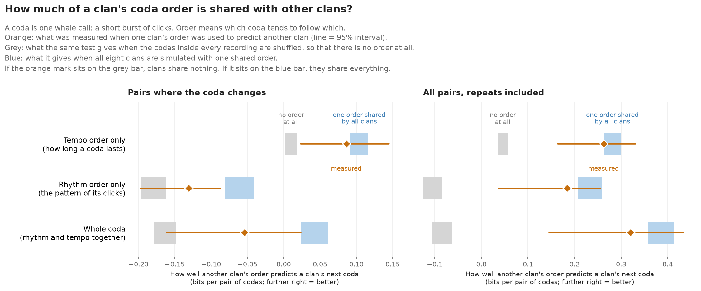

# Coda order in sperm whale clans


**Do sperm whales put their calls in a predictable order, and is that order the same in every clan?**

By Aubrey ([github.com/aubrika](https://github.com/aubrika)). A short write-up for
researchers is in [paper/coda-order.pdf](paper/coda-order.pdf). This project is
ongoing; [what comes next](#what-comes-next) is listed below.

Sperm whales call in short bursts of clicks, called codas. This project uses
published recordings of eight clans of sperm whales to ask two questions. Does
knowing the current coda help to predict the next one? And does what is learned from
one clan help to predict another?

**What this project shows:** a complete analysis in Python, from raw public data to
tested results. One set of commands rebuilds every number and figure. There are 31
automated tests. Each method was first tried on made-up data where the right answer
is known, and results were corrected when those checks failed.

## Results

**In short:**

- In every clan, knowing the current coda helps to predict the next one. Most of
  that help comes from whales repeating the same coda, but some of it is real order.
- Clans share part of that order. How the length of one coda follows the length of
  the one before is close to the same in every clan. How its rhythm follows is less
  shared. The data are not enough to say exactly how much.
- The hope was that one number, a Procrustes distance, could measure how far two
  clans' orders have drifted apart. It cannot, with this much data: two halves of the
  same clan come out almost as far apart as two different clans.



The figure shows the second point. The words in it are explained below, and the
figure itself is explained under
[Do clans put their codas in the same order?](#do-clans-put-their-codas-in-the-same-order)

### Words used here

| Word | Meaning |
|---|---|
| Coda | One whale call: a short burst of clicks. |
| Clan | A group of whales that share a set of codas. This study has eight: one from the Caribbean (EC1) and seven from the Pacific. |
| Rhythm | The pattern of gaps between the clicks of a coda. Each coda is placed in one of 18 rhythm classes. |
| Tempo | How long the whole coda lasts. Each coda is placed in one of five length groups. |
| Coda type | A rhythm and a tempo together. Two codas are the same type only if both match. |
| Inventory | Which coda types a clan uses, and how often it uses each one. |
| Order | Which coda tends to follow which. This is separate from inventory: two clans could use the same codas in a different order, or different codas in the same order. |
| Bits | The unit of the score. A gain of 1 bit means the prediction was twice as good: it gave twice the probability to the coda that really came next. A gain of 0 means no better, and a gain below 0 means worse. |

### How a prediction is scored

Two predictions of the next coda are compared. The first knows only how common each
coda is in that clan. The second also knows the current coda. Both are tested on
recordings that were kept aside and not used to build them. The score is how many
bits better the second prediction is. If the score is above zero, the order of the
codas carries information that their frequency alone does not.

### What the data show

1. **Order helps.** Counting every pair of codas that follow each other, the gain
   for tempo is between +0.15 and +0.86 bits in the eight clans, and is clearly above
   zero in all of them. The gain for rhythm is between +0.07 and +0.78, and is clearly
   above zero in seven of the eight.
2. **Most of that is repetition.** Whales often repeat a coda, and a repeat is easy
   to predict. Counting only the pairs where the coda changes, the gain for tempo
   falls to between +0.03 and +0.64 and is clearly above zero in four clans. The gain
   for rhythm falls to between -0.03 and +0.28 and is clearly above zero in none.
3. **A prediction built from other clans does badly.** A model built from seven clans
   predicts the eighth clan's changes worse than that clan's own coda frequencies do,
   on average: -0.11 bits for tempo and -0.68 for rhythm. But this model brings the
   other clans' inventory with it, and clans use different codas. So this result says
   little about order.
4. **It is order, not just which whales were recorded.** Recordings differ in which
   codas they contain, so the current coda also gives a hint about which recording
   this is. To check that this is not the whole story, the codas inside every
   recording were shuffled, which keeps each recording's codas and destroys their
   order. The real gains are higher than the shuffled ones in all eight clans for
   tempo, and in six of eight for rhythm when only changes are counted. About a third
   of the tempo gain remains after shuffling, so that part was never about order.
5. **With inventory removed, clans share part of their order.** This is the main
   result. It is explained in the next section.

"Clearly above zero" means that the 95% interval does not include zero. For points
1 and 2 the intervals come from 500 resamples of whole recordings.


### Do clans put their codas in the same order?

The idea behind this project is that each clan has its own order, and that these
orders slowly drift apart, as dialects of a language do. Two things are needed to
test that: a way to compare the order of two clans, and a way to turn the comparison
into a distance.

The difficulty is that clans differ first of all in their inventory. That
difference is large, and it hides everything else unless it is removed.

**How order is compared.** Each clan's order is described by small tables: how the
next rhythm depends on the current rhythm, and how the next tempo depends on the
current tempo. These tables can be measured well even when a whole coda type is
rare. To predict clan B with clan A's order, A's tables are combined with B's own
inventory, so the only thing taken from A is its order.

**What the result is compared with.** A score by itself means little here, because
a table measured from a limited number of recordings is partly noise, and noise
taken from one clan makes predictions of another clan worse. So the same test was
run on two kinds of made-up data, to mark the two ends of the scale:

- **No order at all:** the real recordings, with the codas inside each one shuffled.
- **One order shared by all clans:** eight simulated clans that all follow the same
  order, each with its real inventory and recordings of the real sizes.

The figure near the top of this page shows where the measured values fall between
those two ends. In numbers, for pairs where the coda changes:

| Which order is carried from another clan | No order at all | Measured | One shared order |
|---|---:|---:|---:|
| Tempo only | +0.01 | +0.09 | +0.11 |
| Rhythm only | -0.18 | -0.13 | -0.06 |
| Whole coda | -0.16 | -0.05 | +0.04 |

The numbers are bits per pair of codas; higher is better.

- **Another clan's order does carry information.** In every row the measured value
  is above every one of the 40 shuffled versions.
- **But less than a fully shared order would.** In every row the measured value is
  below every one of the 40 simulations of a shared order.
- **Tempo order is close to fully shared. Rhythm order is less so.** The measured
  value is about four fifths of the way from "no order" to "one shared order" for
  tempo, and about two fifths of the way for rhythm.
- **The uncertainty is large.** The orange lines in the figure are 95% intervals.
  For the whole coda the interval reaches almost from one end of the scale to the
  other. The safe statement is that clans share some of their order, more for tempo
  than for rhythm.
- **When repeats are counted too, most order is shared.** Every clan repeats codas,
  and that habit carries over (right-hand panel).

A negative number in the table does not mean that another clan's order "misleads".
It is what noise in the tables costs.

**Can a distance measure the difference?** Not with these data. The Procrustes
distance between two clans' orders is 0.83 to 1.06. But when one clan's recordings
are split into two random halves, the distance between the halves is 0.66 to 1.02.
A measure that puts two halves of the same clan almost as far apart as two different
clans is mostly measuring noise. So the question of drift is still open: this test
could not have answered it either way.

Things to keep in mind:

- **The two ends of the scale are approximate.** The "one shared order" simulation
  gives every clan the same strength of order, set to match the average seen in the
  real data. Real clans differ in strength.
- **The Caribbean clan is 11 whales**, recorded with tags on the animals. The seven
  Pacific clans were recorded from boats, without knowing which whale made each coda.
  Comparisons between the two oceans are comparisons between methods as well.
- **Two codas in a row may come from two whales.** Speakers are not separated, and
  there is no limit on the time between codas. Some of the order found here may be
  whales answering each other.
- **Rhythm classes come from Caribbean codas.** Pacific codas are placed in the
  nearest class, which is only approximate.
- **Shared tempo order may be simple.** Between 48% and 81% of tempo changes are a
  step to the neighbouring length group, more than chance in every clan. So much of
  the shared tempo order may be that the length of codas changes gradually.

[Methods and results](SUMMARY.md) gives the exact definitions and the full tables.

## What this does *not* show

- **Nothing about meaning or syntax.** This measures prediction of recorded token
  sequences. It does not identify meaning, syntax, or individual whales' choices.
- **Not one whale's choices.** Speakers are pooled in the main analysis.
- **Not a like-for-like comparison of oceans.** The Caribbean and Pacific data were
  collected differently, and shared processing does not remove those differences.

See [limitations](limits.md) for the full list.

## What comes next

This project is ongoing. The next steps, in order:

- [ ] **Pacific clans alone, with their own coda types.** The seven Pacific clans
  were recorded in the same way and already have their own coda types, which makes
  for a cleaner comparison than mixing two oceans.
- [ ] **Shared order against how much clans meet.** Do clans that live in the same
  waters share more of their order, or less? This brings in a measure from outside
  the recordings, which the current results lack.
- [ ] **One whale's sequence against whales answering each other.** The Caribbean
  data say which whale made each coda, and when, so the two can be told apart.
- [ ] **Tempo as a measured length, not five groups,** to see how much of the shared
  tempo order is simply gradual change.
- [ ] **A distance that is more than noise.** Any new measure has to put two halves
  of one clan clearly closer together than two different clans.

## Reproduce

The committed CSVs and figures can be inspected without downloading data.
The September 2026 rerun used Python 3.14.5; direct dependency versions are pinned.

```bash
python -m venv .venv
# Linux/macOS:
source .venv/bin/activate
# PowerShell alternative: .venv\Scripts\Activate.ps1
python -m pip install -r requirements-dev.txt

python data/fetch.py all
python data/fetch.py all --verify
```

The fetcher checks input SHA-256 digests against [the source manifest](data/sources.json).
Raw data are fetched separately; source details are in [provenance](data/raw/PROVENANCE.md).
The source includes Python pickles, read during EC1 preprocessing and rhythm-template
loading. Only use the recorded inputs.

Set the source path once:

```bash
export PYTHONPATH=src
# PowerShell alternative: $env:PYTHONPATH = "src"
```

Then run:

```bash
python -m coda_recovery.predictive_info_sweep
python -m coda_recovery.universal_structure
python -m coda_recovery.clan_similarity
python -m coda_recovery.drift
python -m coda_recovery.ordering_drift
python -m coda_recovery.coda_ordering
python -m coda_recovery.ordering_checks
python -m coda_recovery.describe
python -m coda_recovery.ec1_pacified
python -m coda_recovery.plain_figures
python -m pytest
```

These commands replace the corresponding files in `results/` and `figures/plain/`.
Tests cover independent and deterministic sequences, the changes-only baseline,
recording folds, bootstrap refitting, and cross-clan transfer.

## Read the code

| File | Purpose |
|---|---|
| [standardize.py](src/coda_recovery/standardize.py) | Shared tokenization and adjacent recording pairs |
| [predictive_info.py](src/coda_recovery/predictive_info.py) | Model scores, grouped cross-validation, recording bootstrap |
| [universal_structure.py](src/coda_recovery/universal_structure.py) | Leave-one-clan-out comparison |
| [clan_similarity.py](src/coda_recovery/clan_similarity.py) | Pairwise transfer and descriptive embedding distances |
| [drift.py](src/coda_recovery/drift.py) | Mantel tests relating Procrustes distance to lost predictability |
| [ordering_drift.py](src/coda_recovery/ordering_drift.py) | The same question for one feature at a time, with coda frequencies taken out |
| [coda_ordering.py](src/coda_recovery/coda_ordering.py) | Model of whole-coda order; transfer between clans on each clan's own inventory |
| [ordering_checks.py](src/coda_recovery/ordering_checks.py) | The reference points: shuffled recordings, one shared order, and the noise in the distance |
| [describe.py](src/coda_recovery/describe.py) | Sample sizes for each clan |

## History and corrections

The repository is called coda-recovery after an earlier attempt to recover coda
labels by graph matching.
[Development history](PROGRESS.md) records that change of direction.

**Correction, September 2026.** An earlier version of the changes-only comparison
used a baseline that still assigned probability to the excluded current coda.
Independent five-token data could therefore score about +0.32 bits solely because
repeats were removed. The baseline now accounts for the exclusion, and the earlier
claims of a universal tempo rule and above-zero changes-only effects in every clan
have been withdrawn. [Methods and results](SUMMARY.md#correction-to-the-earlier-analysis)
explains the correction.

## License and credits

The code is released under the [MIT License](LICENSE). The data are not mine and are
not redistributed here: the Caribbean recordings are from Sharma et al. (2024) and the
Pacific recordings from Hersh et al. (2022), fetched from their public deposits as
described in [provenance](data/raw/PROVENANCE.md).

Built with AI coding assistance (Claude Code). The questions, the analysis decisions
and the conclusions are mine.
