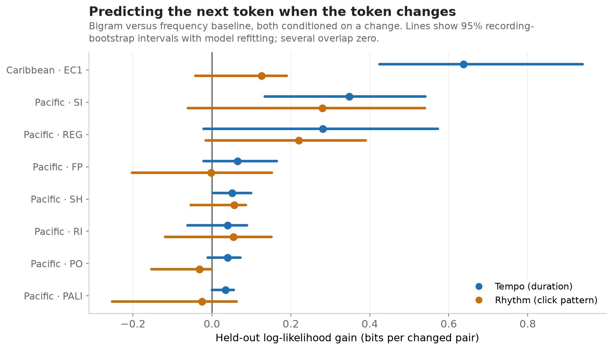
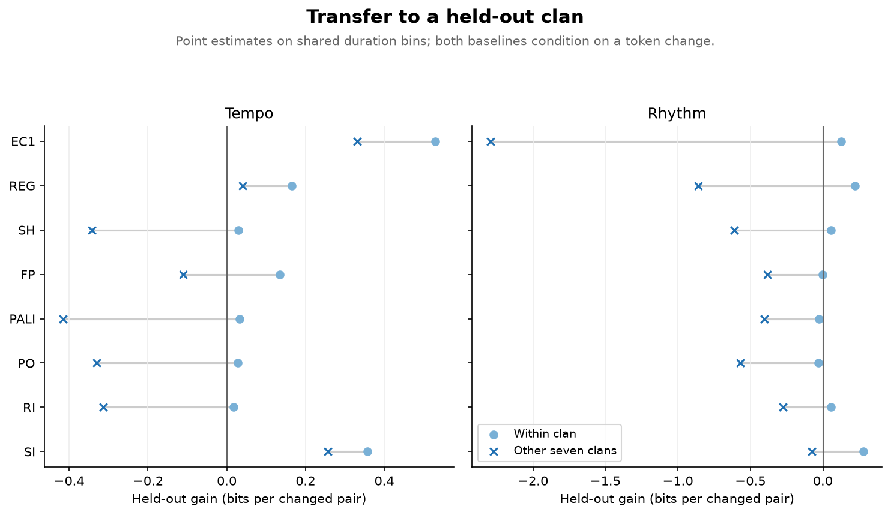

# Methods and results

This analysis asks whether a first-order sequence model predicts adjacent coda
tokens better than a frequency model, within and between the sampled vocal clans.
Results below were regenerated on 2026-09-26.

## Data and representation

The main analysis uses Caribbean EC1 data from Sharma et al. (2024), Dataset 2,
and seven Pacific clans from Hersh et al. (2022). Input files and digests are
listed in [data/sources.json](data/sources.json); acquisition details are in
[data/raw/PROVENANCE.md](data/raw/PROVENANCE.md).

Rhythm is assigned to the nearest EC1 template of the same click count, using
normalized cumulative inter-click intervals. Duration has two representations:

- Within-clan sweep: five per-clan quantile bins.
- Cross-clan comparisons: fixed EC1 duration edges, shared across clans.

These are different analysis frames. Their tempo scores should not be compared
as though the tokens were identical. Bins, templates, and vocabulary are fixed
before cross-validation; intervals are conditional on this representation.

Pairs join adjacent codas within a recording, pooling speakers. EC1 uses onset
order. Pacific data use coda numbers and reject gaps greater than one after
filtering. These rules do not identify conversational turns. The EC1 supplement
uses known speakers and an eight-second onset-gap limit.

## Score and baseline

The score is the average held-out log-likelihood gain:

```text
gain = mean(log2 P_sequence(next | current) - log2 P_baseline(next | current))
```

Positive values favor the sequence model; negative values favor the baseline.
This is a fitted-model prediction score, not an exact mutual-information estimate.
Its units are bits per scored pair.

For all-pair scoring, the baseline is the smoothed destination frequency in the
training recordings. The sequence model is a smoothed bigram, with alpha = 0.5.

For changes-only scoring, only pairs with different source and destination tokens
are evaluated. Both models assign zero probability to the excluded destination.
The bigram is normalized over its off-diagonal row. The baseline is estimated
from **all** training destinations, then conditioned on a change:

```text
P_baseline(b | a, b != a) = (n_b + alpha) / (N - n_a + alpha * (V - 1))
```

Here n_b counts destination b, N counts all training pairs, and V is vocabulary
size. This baseline represents draws from the training destination frequencies
subject to the known exclusion. It does not remove every possible effect of
repetition, recording context, or speaker composition.

## Correction to the earlier analysis

The earlier changes-only analysis filtered training and test pairs, but retained
an unconditional frequency baseline. That baseline spent probability on an outcome
excluded by construction, giving the bigram an artificial advantage.

For independent uniform five-token data, conditioning on a change leaves four
possible destinations. The old comparison could approach log2(5/4), about
0.322 bits, without any original sequence dependence. The regression test now
returns zero on balanced independent data, and checks nonuniform data too.

The previous uncertainty calculation resampled overlapping split scores.
It has been replaced with the recording bootstrap described below. Because both
the estimator and uncertainty method changed, new results supersede the previous
CSVs and figures. The previous universal-tempo and all-clans changes-only claims
are withdrawn.

## Cross-validation and uncertainty

Recordings are assigned to five disjoint folds using seed 0 (fewer folds if fewer
than five recordings exist). Each pair is scored once, using models fitted on the
other folds. The overall estimate is weighted by the number of scored pairs,
rather than giving a small fold the same weight as a large one.

For each of 500 bootstrap replicates, recordings are sampled with replacement
within each fixed fold. All pairs belonging to a sampled recording are retained;
duplicate copies remain in that fold. Both models are refitted on every replicate.
The 2.5th and 97.5th percentiles form the reported intervals.

This estimates recording-sampling uncertainty conditional on the folds and tokens.
It assumes recordings are independent sampling units, which cannot be established
from the available whale identities. It does not include uncertainty in template
selection, bin edges, or study design. With few recordings, the tails are unstable.
Intervals are exploratory and are not adjusted for multiple comparisons.

## Within-clan results

The [sweep CSV](results/predictive_info_sweep.csv) includes estimates, interval
endpoints, numbers of pairs and recordings, and bootstrap settings.

| Token | All-pair point-estimate range | Changes-only point-estimate range |
|---|---:|---:|
| Tempo | +0.154 to +0.861 | +0.034 to +0.638 |
| Rhythm | +0.069 to +0.783 | -0.032 to +0.279 |
| Joint rhythm/tempo | +0.154 to +0.965 | -0.104 to +0.593 |

All-pair tempo intervals are above zero in all eight clans. Rhythm's all-pair
interval crosses zero for PO. Changes-only rhythm intervals have no positive
lower bounds; tempo intervals cross zero in several clans. PALI's tempo lower
bound is close to zero and should not carry a strong interpretation.



## Transfer between clans

The leave-one-clan-out bigram is fitted on seven clans. For each fold of the
eighth clan, its baseline is fitted on the remaining target-clan recordings.
The foreign bigram never trains on the target clan. Both distributions condition
on a change, and scores are weighted by changed pairs.

| Token | Positive transfer estimates | Mean transfer gain |
|---|---:|---:|
| Tempo | 3 / 8 | -0.111 |
| Rhythm | 0 / 8 | -0.684 |
| Joint rhythm/tempo | 0 / 8 | -1.365 |

These are descriptive point estimates, without transfer confidence intervals.
They do not establish that clans share no structure: sparse counts, unequal
training sizes, tokenization, and distribution shift can all reduce transfer.



The [pairwise comparison](results/clan_similarity.csv) is a separate all-pair
analysis, retaining its 15 repeated recording splits. Its off-diagonal models
perform worse than the target-clan frequency baseline in this dataset. This
comparison mixes inventory and transition differences.

The Procrustes figure compares five-dimensional PMI embeddings on the 15 most
frequent pooled joint tokens, including smoothed cells for absent tokens.
Distances describe fitted embeddings; a nonzero distance is not a significance
test or proof of a distinct grammar.

## Artifacts

| Output | Script |
|---|---|
| Within-clan CSV, figure 2 | `predictive_info_sweep`, then `plain_figures` |
| Leave-one-clan-out CSV, figure 3 | `universal_structure` |
| Pairwise CSV, figures 4 and 5 | `clan_similarity` |
| Native vs pooled EC1 CSV | `ec1_pacified` |
| Token-count overview, figure 1 | `plain_figures` |

Figure 1 uses fixed duration edges; figure 2 uses per-clan quantiles. Reproduction
commands are in the [README](README.md). [Limitations](limits.md) covers the
remaining sampling and interpretation issues.
